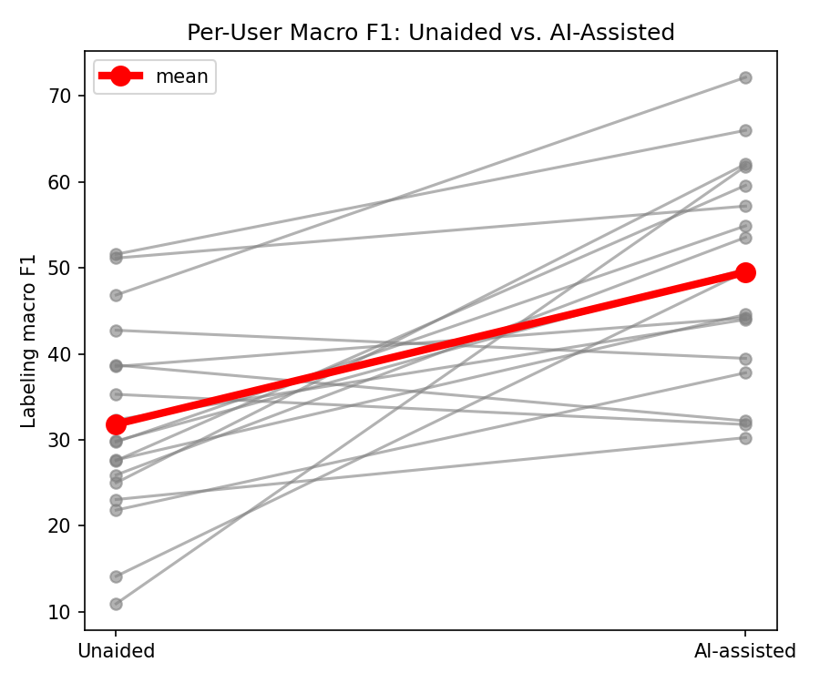
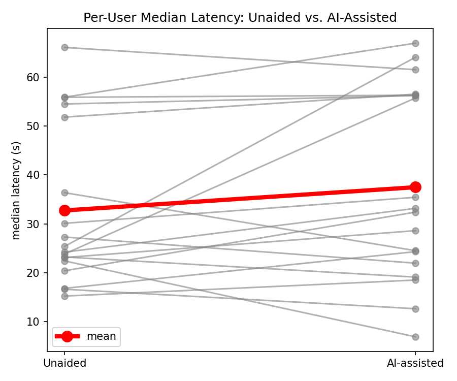
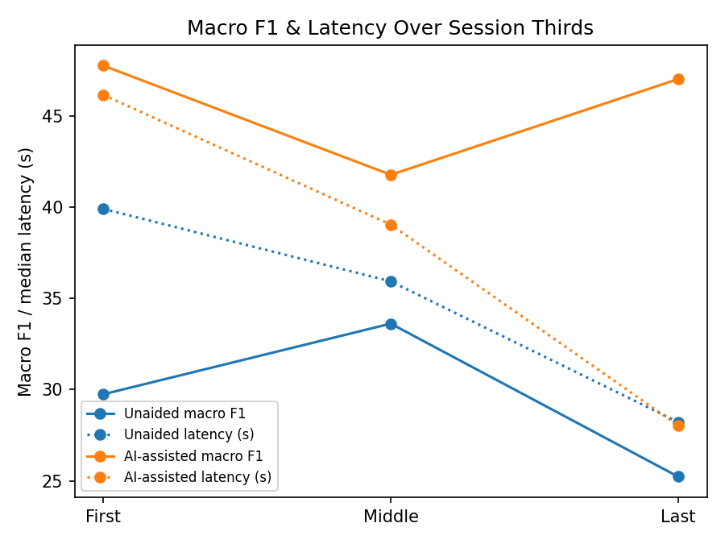

# HITL Evaluation

Results of the human-in-the-loop (HITL) labeling evaluation.

## 1. Experimental Setup

To evaluate whether AI assistance improves human labelling quality, a controlled, within-subject labelling study was conducted. The analysis covers 18 participants with a complete pair of labeling sessions. Each participant completed two counterbalanced sessions of approximately 90 minutes on separate days, performing the same underlying task (assigning incoming IT support tickets to one of 25 IT support teams) under both experimental conditions.

In the unaided (control) condition, participants viewed only the raw ticket text and labelled it manually, without additional support. The model's predictions were logged in the background but not shown. In the AI-assisted (treatment) condition, participants were additionally shown:

- the model's top-2 predicted team labels, where the top-ranked label is the model prediction;
- the confidence score, which reflects the model's certainty;
- LIME local feature attributions, highlighting the keywords driving each prediction;
- two sets of similar historical tickets, each shown with its known ground-truth label: closest predicted-class tickets (the most similar already-labelled tickets whose label matches the model's predicted team) and closest past tickets (the most similar already-labelled tickets).

Both conditions ran on a live active learning loop, in which a logistic regression classifier was retrained after every submitted label. In the AI-assisted condition, participants could confirm the model's top prediction or override it with an alternative label. In both conditions, participants could flag that they did not know the correct assignment (IDK), and a label could be marked as difficult.

After filtering out the participants labeling less than 20 tickets, 18 participants were left in the analysis. For each of the remaining 18 participants, both sessions were truncated to the smaller scorable count in the pair (N), taking labels in labelling order, so each participant contributes the same number of scorable labels to each condition. N ranged from 21 to 172 labels (median 63). The analysed windows contain 2,548 scorable labels (labels other than IDK; 1,274 per condition) and 166 IDK labels, 2,714 labels in total, out of 3,430 recorded before truncation. 

Most participants had no prior experience with IT support ticket management (15 of 18), and 10 of 18 had used model-assisted tools for classification or labelling before.

Macro F1, correction rates and latency are computed per participant and condition first; means, differences and Wilcoxon signed-rank tests are then taken across the 18 participants. Latency uses only scorable labels under 10 minutes. Wilcoxon p-values are given wherever a test was run; the session thirds and questionnaire results are descriptive only.

## 2. Labelling Macro F1

Labelling quality is measured against the ground-truth team of each ticket. Macro F1 is computed per participant and session on the truncated windows.

| Measure | Unaided (Control) | AI-assisted (Treatment) | Difference | Wilcoxon p |
|---|---|---|---|---|
| Macro F1 | 31.8% | 49.5% | +17.7 pp | 0.0002 |

*n = 18 participants; Wilcoxon signed-rank test; pp = percentage points.*

Mean macro F1 rose from 31.8% unaided to 49.5% with AI assistance, a gain of 17.7 percentage points (Wilcoxon signed-rank, n = 18, p = 0.0002). Fifteen of the 18 participants scored higher on macro F1 with AI assistance, and the other three scored lower.

*Figure 1: Per-participant macro F1, unaided vs. AI-assisted. Grey lines are individual participants; the red line is the mean.*

## 3. Model Correction & False Model Correction Rate

Two rates describe how participants treated the model's top prediction:

- **Model correction rate:** the probability that the participant's label is correct when the model's top prediction is wrong.
- **False model correction rate:** the probability that the participant's label is wrong when the model's top prediction is correct.

In the unaided condition the prediction was hidden, so both rates describe the participant's own labels against what the model would have predicted. On average, each participant had about 31 labels in which the model's top prediction was wrong and about 40 in which it was correct, in both conditions.

### 3.1 Correction Rates

| Rate | Unaided (Control) | AI-assisted (Treatment) | Difference | Wilcoxon p |
|---|---|---|---|---|
| Model correction rate | 23.6% | 27.0% | +3.5 pp | 0.8650 |
| False model correction rate | 55.1% | 32.9% | -22.2 pp | 0.0013 |

AI assistance mainly lowered the false model correction rate: participants were much less likely to end up with a wrong label when the model was right, falling from 55.1% to 32.9% (p = 0.0013). The model correction rate changed little, from 23.6% to 27.0% (p = 0.8650). The macro F1 gain therefore appears to come mainly from keeping correct suggestions, not from catching wrong ones.

When the model's top prediction was wrong, participants reached the correct team in only about a quarter of labels in both conditions. This is consistent with automation bias, in which people defer to suggestions rather than challenge them.

### 3.2 IDK and Difficult Rates

The IDK rate is the share of all labels in the window flagged as "I don't know". The difficult rate is the share of all labels in the window marked as difficult, with blank answers counted as not difficult. Both rates include IDK labels in the denominator. The windows contain 100 IDK labels unaided and 66 with AI assistance.

| Rate | Unaided (Control) | AI-assisted (Treatment) | Difference | Wilcoxon p |
|---|---|---|---|---|
| IDK rate | 7.8% | 6.6% | -1.3 pp | 0.4703 |
| Difficult rate | 7.8% | 6.6% | -1.2 pp | 0.3627 |

Neither flag differed significantly between conditions (14 of 18 participants had a non-zero difference for each flag). Both averages are low, but use varied widely across participants. The highest AI-assisted values came from one participant, who flagged 43.2% of labels as IDK and 59.5% as difficult.

## 4. Latency & Sustained Performance

### 4.1 Latency Comparison

Averaged over participants, the per-participant median label latency was 32.7 s unaided and 37.5 s with AI assistance, a difference of +4.8 s. This difference is not statistically significant (Wilcoxon signed-rank, n = 18, p = 0.1815), and 12 of 18 participants were slower with AI assistance.

| Measure | Unaided (Control) | AI-assisted (Treatment) | Difference | Wilcoxon p |
|---|---|---|---|---|
| Mean of per-participant median latency | 32.7 s | 37.5 s | +4.8 s | 0.1815 |
| Median of per-session medians | 24.8 s | 32.8 s | — | not tested |

AI assistance was therefore numerically slower, though not significantly so. One participant wrote that waiting for the model assistance to appear "sometimes literally slowed me down" (AI-assisted questionnaire, Q10). That is a single account and cannot be checked against the logs, but it points to a possible interface delay as one contributor.

*Figure 2: Per-participant median label latency, unaided vs. AI-assisted, excluding latencies of 10 minutes or more. Grey lines are individual participants; the red line is the mean.*

### 4.2 Session Thirds Comparison

Each truncated session was split by position into first, middle and final thirds. Values are averaged over the 18 sessions per condition; latency is the mean of the per-session-third medians.

| Condition | Third | Macro F1 | Latency |
|---|---|---|---|
| Unaided (Control) | First | 29.7% | 39.9 s |
| Unaided (Control) | Middle | 33.6% | 35.9 s |
| Unaided (Control) | Final | 25.2% | 28.2 s |
| AI-assisted (Treatment) | First | 47.7% | 46.1 s |
| AI-assisted (Treatment) | Middle | 41.8% | 39.0 s |
| AI-assisted (Treatment) | Final | 47.0% | 28.0 s |

Unaided performance peaked in the middle third and then fell. From the first to the final third, macro F1 dropped by 4.5 points. With AI assistance, macro F1 stayed close to its opening level (47.7% to 47.0%). The AI-assisted advantage in macro F1 was 18.0 points in the first third, 8.2 points in the middle third and 21.8 points in the final third.

Latency was higher with AI assistance in the first and middle thirds (by 6.2 s and 3.1 s) and similar in the final third. Latency fell across the session in both conditions, by 11.7 s unaided and 18.1 s with AI assistance, so the two conditions converged by the final third (28.2 s and 28.0 s). Because the decline appears in both conditions, it looks more like familiarity with the labelling workflow than a condition-specific fatigue effect, though the thirds data alone cannot separate the two.

The unaided decline in the final third is consistent with the non-linear performance decay predicted by the untiring-oracle critique of conventional active learning. The stable AI-assisted performance is preliminary evidence that XAI-augmented assistance may help offset the decline seen in unaided annotation.

*Figure 3: Macro F1 (solid lines, %) and median label latency (dotted lines, s) across the first, middle and final third of each truncated session. Blue: unaided; orange: AI-assisted.*

## 5. Questionnaire Analysis

Questionnaire items use 5-point scales unless stated otherwise. Percentages are shares of the respondents who answered each item. No significance tests were run on the questionnaires.

### 5.1 Overall Comparison Questionnaire (n = 17)

**Preference.** 14 of 17 respondents (82.4%) found it easier to work with AI assistance, two (11.8%) found the two conditions about the same, and one (5.9%) found it easier without AI assistance.

| Statement | Mean | Median | Agree (4-5) | Disagree (1-2) |
|---|---|---|---|---|
| Q3a. I felt my labels were more accurate with AI assistance | 3.82 | 4 | 76.5% | 5.9% |
| Q3b. AI assistance made me label faster overall | 3.94 | 4 | 76.5% | 11.8% |
| Q3c. Labelling with AI assistance required less mental effort than without it | 3.65 | 4 | 70.6% | 17.6% |
| Q3d. I sometimes over-relied on the AI suggestions and accepted them without checking | 2.76 | 2 | 41.2% | 52.9% |
| Q3e. AI assistance changed how I labelled tickets later in the task | 3.35 | 4 | 52.9% | 17.6% |
| Q3f. For real ticket labelling work, I would prefer the AI-assisted tool over manual labelling | 4.29 | 4 | 82.4% | 0.0% |

**Perceived accuracy and speed.** Most respondents agreed that their labels were more accurate with AI assistance (76.5%, mean 3.82). This matches the measured gain in macro F1 in Section 2. Most also agreed that AI assistance made them label faster overall (76.5%, mean 3.94). The per-label latency data do not show a speed gain: median latency was numerically higher with AI assistance (+4.8 s, p = 0.1815, Section 4.1). The questionnaire item asks about overall speed, which the logged latency data do not measure, so the speed benefit should be read as perceived rather than measured.

**Mental effort.** 70.6% agreed that labelling with AI assistance required less mental effort (mean 3.65).

**Over-reliance.** Self-reported over-reliance was moderate: 41.2% agreed that they sometimes accepted suggestions without checking, and 52.9% disagreed (mean 2.76). The behavioural data point the same way but do not isolate the cause. When the model's top prediction was wrong, 73% of AI-assisted labels did not reach the correct team (Section 3.1). That share includes any wrong label, not only accepted suggestions.

**Changes over the task.** 52.9% agreed that AI assistance changed how they labelled later in the task (mean 3.35). One participant described growing confidence in the suggestions over time.

**Future use.** 82.4% agreed that they would prefer the AI-assisted tool for real ticket labelling work (mean 4.29). No respondent disagreed; the remaining three were neutral.

### 5.2 AI-Assisted Questionnaire: Cue Comparison (n = 18)

Five cues were rated for usefulness (Q4a-e, 1 = not useful, 5 = extremely useful). Participants also ranked their three most helpful cues (Q5a-c), named the least helpful or confusing feature (Q7), and rated the clarity of the explanations (Q8a-b).

| Cue | Mean | Median | Useful (4-5) | Not useful (1-2) |
|---|---|---|---|---|
| Model prediction (suggested label) | 3.61 | 4 | 61.1% | 5.6% |
| Closest predicted-class tickets | 3.28 | 3.5 | 50.0% | 22.2% |
| Closest past tickets | 3.11 | 3.5 | 50.0% | 38.9% |
| Confidence scores | 2.89 | 3 | 22.2% | 38.9% |
| LIME explanations (highlighted words) | 2.56 | 2 | 33.3% | 55.6% |

| Cue | 1st | 2nd | 3rd | Top-3 placements (of 54) | Named least helpful (of 18) |
|---|---|---|---|---|---|
| Model prediction (suggested label) | 13 | 2 | 2 | 17 | 1 (5.6%) |
| Confidence scores | 1 | 9 | 3 | 13 | 4 (22.2%) |
| Closest predicted-class tickets | 0 | 5 | 5 | 10 | 1 (5.6%) |
| Closest past tickets | 4 | 2 | 2 | 8 | 3 (16.7%) |
| LIME explanations (highlighted words) | 0 | 0 | 6 | 6 | 9 (50.0%) |

*Top-3 placements count how often each cue was placed 1st, 2nd or 3rd. Each respondent gives one cue per position, so the total is 18 × 3 = 54.*

The explanations themselves were judged clear: 77.8% agreed that the XAI explanations were clear and easy to understand (Q8a, mean 3.83). Only 22.2% agreed that they noticed inconsistencies between LIME explanations and similar tickets (Q8b, mean 2.94, with 50.0% neutral).

**Model prediction.** The suggested label was the most valued cue. It had the highest usefulness rating (61.1% useful), was placed first by 13 of 18 respondents, and was named least helpful by one respondent. Participants explained why: confirming a correct suggestion removed the need to search the team list.

**Closest tickets.** Both similar-ticket cues were rated useful by half of the respondents, with close means (3.28 and 3.11). Closest predicted-class tickets were placed in the top three slightly more often (10 vs. 8 placements) and were named least helpful less often (1 vs. 3 respondents). One participant named similar-ticket labels as the most useful feature for them, while another found it unclear whether the closest past tickets were past tickets or predictions for similar tickets.

**Confidence scores.** Confidence scores were rated low (22.2% useful), yet nine respondents placed them second, the most common second-place choice, and four named them least helpful. This combination suggests a supporting role next to the prediction rather than a standalone aid. Two participants asked for them to be easier to interpret or more highlighted.

**LIME explanations.** LIME was the weakest cue: it had the lowest mean (2.56), a majority rated it not useful (55.6%), and half of the respondents named it least helpful. It was never placed first or second. The explanations were nevertheless judged clear, so the weakness appears to be usefulness rather than comprehension. The comments point to the keyword highlights. One participant would remove the word explanations, which they found more confusing than helpful, and another noticed that the email's label shaped the predictions without appearing in the explanations.

Overall, the suggested label and the two similar-ticket cues were rated most useful, and LIME least useful. Some comments argue for fewer aids: one participant would prefer "only one tool (with AI assistance)", such as only the model prediction or only similar tickets.
