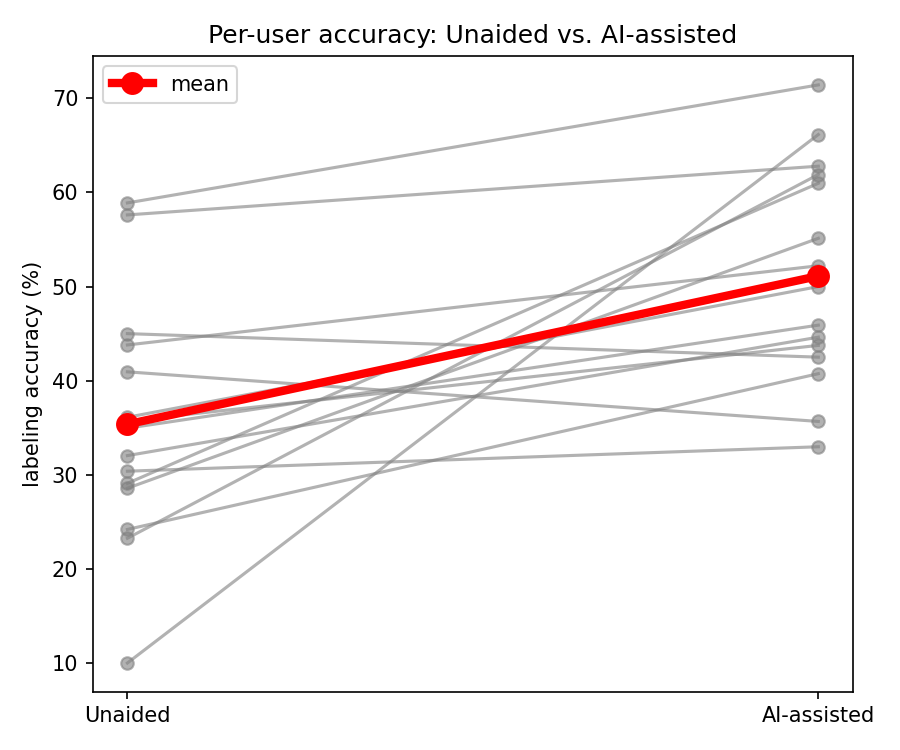
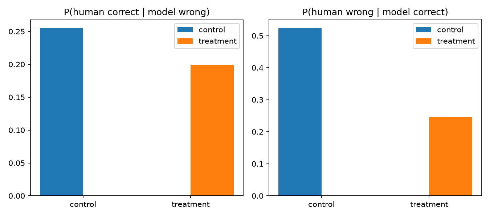
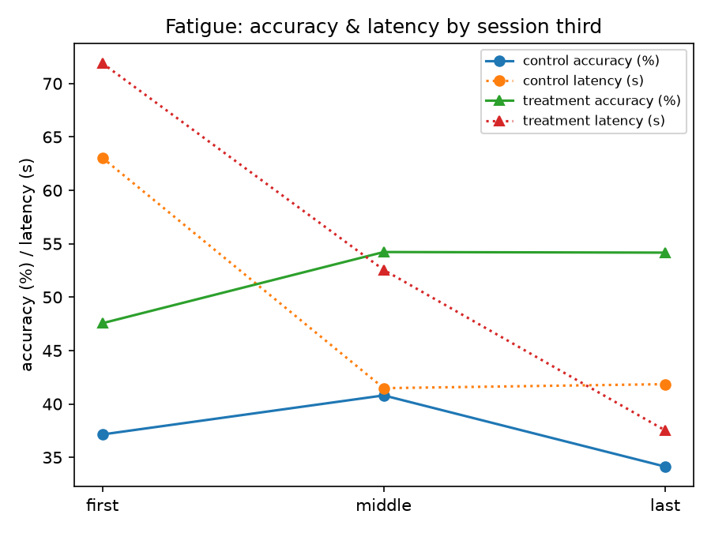
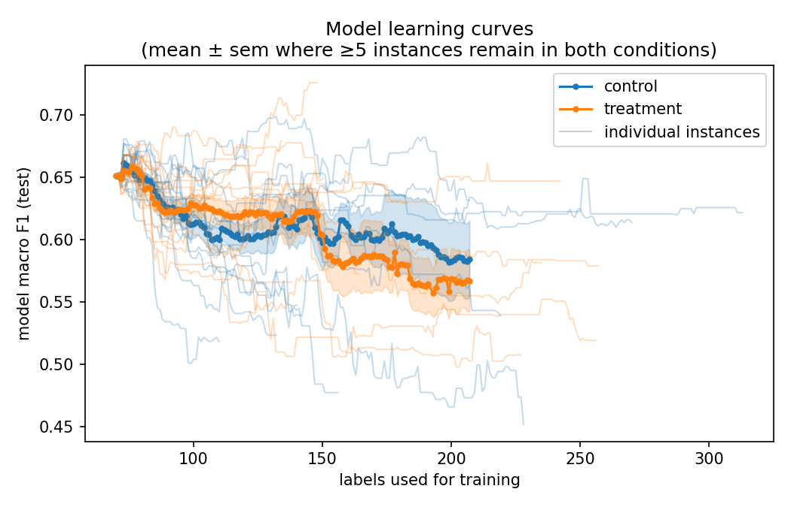

# HITL Evaluation — Additional Results

Supplementary material for the human-in-the-loop (HITL) labeling evaluation described in the main deliverable.

## Experimental Setup

To evaluate whether AI assistance improves human labelling quality, a controlled, within-subject labelling study was conducted with 9 participants to date, with additional participants currently being recruited and results still being gathered. Each participant completed two counterbalanced sessions of approximately 90 minutes on separate days, performing the same underlying task — assigning incoming IT support tickets to one of 25 IT support teams — under both experimental conditions. In the unaided (Control) condition, participants viewed only the raw ticket text and labelled it manually, without algorithmic support. In the AI-assisted (Treatment) condition, participants were additionally shown the model's top-2 predicted team labels, LIME local feature attributions highlighting the keywords driving each prediction, and a set of similar historical tickets together with their known ground-truth labels. Both conditions ran on a live active learning loop, in which a logistic regression classifier was retrained after every submitted label. Within the Treatment condition, participants could confirm the model's top prediction, override it with an alternative label, or explicitly flag that they did not know the correct assignment. Across both conditions, the study yielded 1,518 labelled decisions in total (790 unaided, 728 AI-assisted), extracted from the interaction logs generated by the application.

## Labelling Accuracy

The primary outcome measure is human labelling accuracy, evaluated against the ground-truth team assignment for every labelled ticket. AI assistance produced a substantial and statistically significant accuracy gain: mean accuracy rose from 34.4% in the unaided condition to 56.8% in the AI-assisted condition, an improvement of 22.4 percentage points (Wilcoxon signed-rank test, n = 9, p = 0.008). Eight of the nine participants showed higher accuracy under the AI-assisted condition, and the effect held regardless of the order in which participants encountered the two conditions — consistent with a genuine treatment effect rather than a practice or sequencing artifact.

*Figure 1: Per-user labelling accuracy comparison of the two conditions: unaided vs. AI-assisted.*

## Improvement Analysis

A closer analysis of individual decisions indicates that the accuracy gain is driven primarily by participants adopting correct model suggestions, rather than by participants catching and correcting model errors. Agreement with the model's top prediction rose from 41% in the unaided condition (where model predictions were logged in the background but not shown to participants) to 67% in the AI-assisted condition, and the share of labels falling within the model's top-2 predictions rose from 63% to 87%. When participants accepted the model's top prediction, their resulting accuracy was high (65%), whereas deviating from the model's suggestion was markedly more error-prone (25% accuracy). Conditional on the model's top prediction being wrong, participants corrected it only 20% of the time, which is a pattern consistent with the automation-bias dynamic described above, in which human oversight tends to defer to rather than critically challenge model suggestions.

*Figure 2: Human-model complementarity. Left: probability that the participant corrects a wrong model top prediction. Right: probability that the participant introduces an error when the model's top prediction is correct, by condition.*

## Sustained Performance Over Time

A recurring concern in Human-in-the-Loop decision support is that its benefit erodes as operator fatigue accumulates over a session. To assess this, accuracy and decision latency were compared across the first, middle, and final third of each session. In the unaided condition, accuracy declined from 37% in the first third to 34% in the final third, which is consistent with the non-linear performance decay predicted by the untiring-oracle critique of conventional active learning. In the AI-assisted condition, by contrast, accuracy rose from 48% to 54% over the same period, with no additional time cost: median decision latency did not differ significantly between conditions (Wilcoxon signed-rank test, p = 0.57). Response time decreased over the course of the session in both conditions, most plausibly reflecting a learning effect as participants grew familiar with the interface and labelling workflow, rather than a fatigue signal. Critically, the accuracy advantage conferred by AI assistance was maintained throughout the session: the AI-assisted condition not only began at a higher accuracy level but sustained, and slightly improved on, that level through to the end of the session. This is preliminary evidence that XAI-augmented assistance can help offset the cognitive depletion that unaided annotation is prone to.

*Figure 3: Labelling accuracy and latency (human decision time) based on session thirds.*

*Figure 4: Model macro-F1 learning curves in the live active learning loop, mean ± SEM across participants (shown where ≥5 instances remain in both conditions).*

## User Perception

Participants' subjective ratings closely mirrored the objective performance results. Asked which condition they found easier to work in, 7 of 10 respondents preferred AI assistance, 2 preferred unaided labelling, and 1 was neutral. Participants agreed that their labels were more accurate under AI assistance (mean 3.6/5), that they labelled faster (3.7/5), and that the task required less mental effort (3.5/5), which is a subjective corollary to the cognitive workload relief the broader framework aims to achieve through XAI-informed, progressive-disclosure interfaces. The highest-rated item concerned real-work preference: all respondents were neutral or positive about adopting the AI-assisted tool for actual ticket-labelling work, with 80% agreeing or strongly agreeing (mean 4.3/5). Participants expressed only moderate concern about over-relying on the model's suggestions (mean 2.9/5), consistent with the earlier finding that agreement with suggestions remained selective rather than blind, and with the framework's broader emphasis on calibrated trust over automation bias. Free-text responses pointed to two concrete mechanisms underlying this benefit: AI assistance removed the need to hold team assignments in working memory, and it frequently reframed the labelling task from open-ended recall into simple confirmation.
